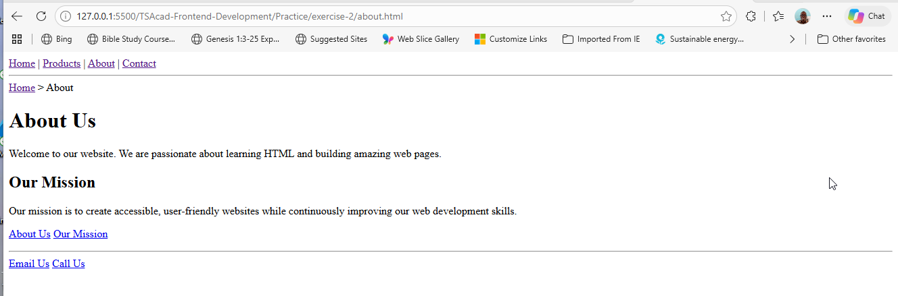
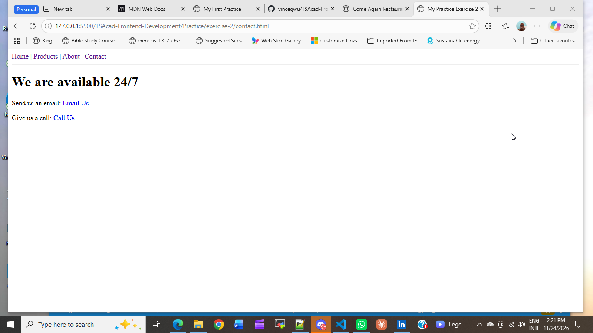
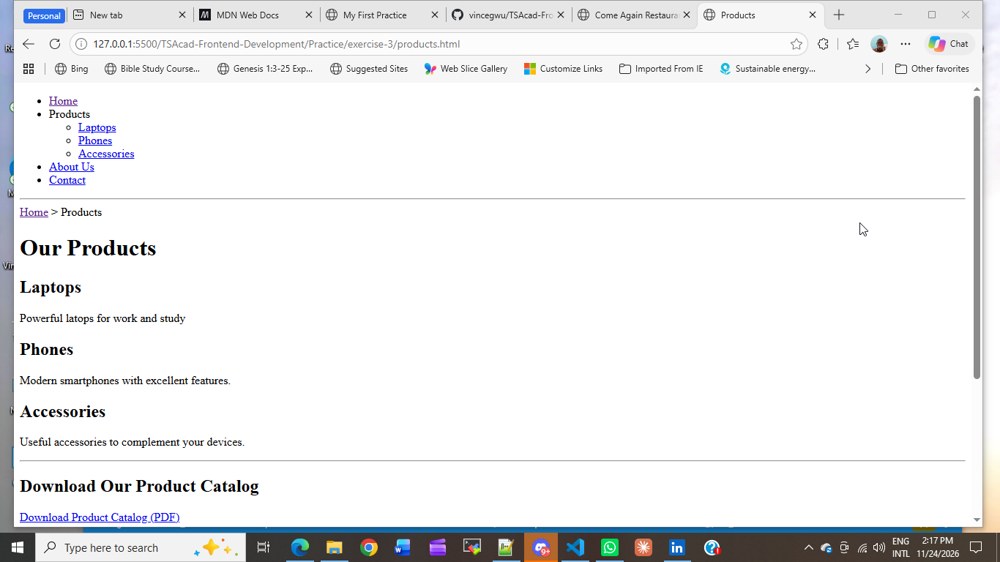
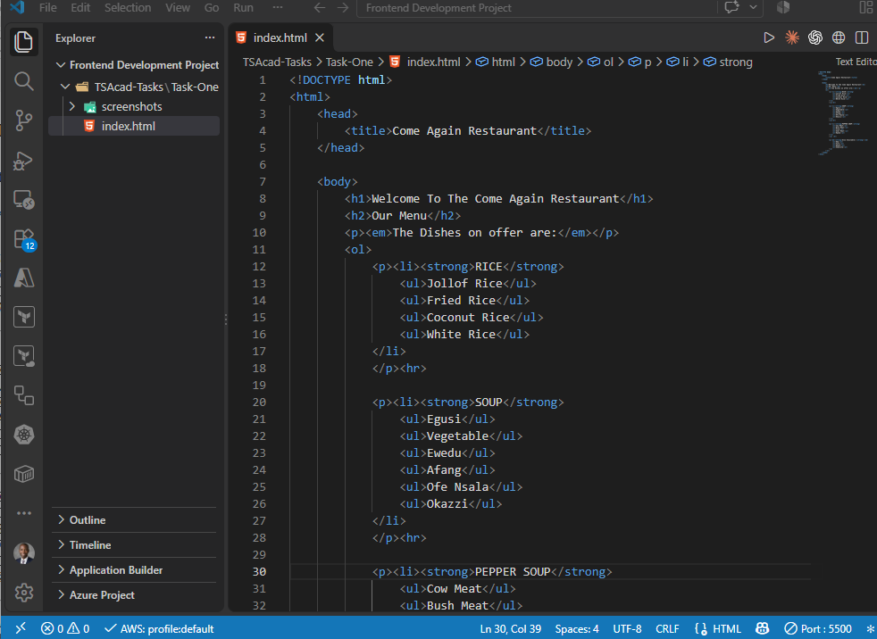
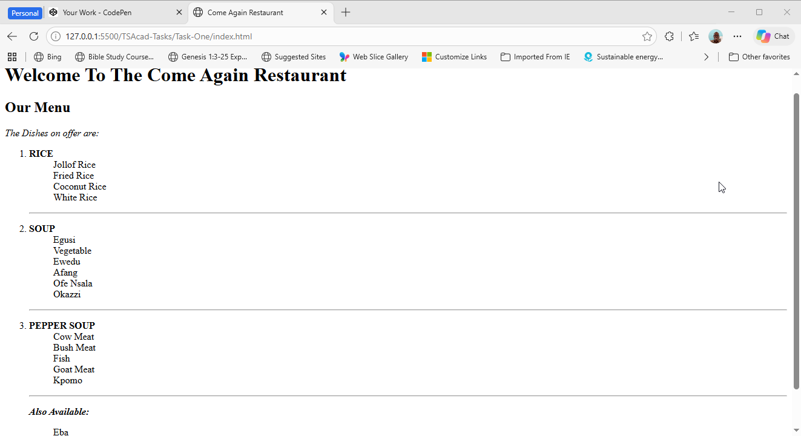

# TS Academy Frontend Development Journey

This repository tracks my progress through the **TS Academy Frontend Development** training. It holds my practice exercises, graded tasks, and notes as I learn to build for the web, starting with HTML and moving on to CSS, JavaScript, and more.

## Repository Structure

```
TSAcad-Frontend-Development/
├── Practice/
│   ├── exercise1.html          # Lists, headings, and definition lists
│   ├── exercise-2/             # Multi-page site with navigation
│   │   ├── index.html
│   │   ├── about.html
│   │   └── contact.html
│   ├── exercise-3/             # Products page, nested menus, file download
│   │   ├── products.html
│   │   └── IT Hardware Brochure.pdf
│   └── screenshots/
└── Task-One/                   # Come Again Restaurant menu page
    ├── index.html
    └── screenshots/
```

## Progress Log

### Practice Exercises

| Exercise | Topic | What I Practised |
|----------|-------|------------------|
| [Exercise 1](Practice/exercise1.html) | My Favourite Foods | Headings, unordered lists (`<ul>`), ordered lists (`<ol>`), definition lists (`<dl>`), external links |
| [Exercise 2](Practice/exercise-2/index.html) | Multi-page Website | Linking pages with relative paths, `<nav>`, `aria-current`, breadcrumbs, in-page anchor links, `mailto:` and `tel:` links, `<main>`, `<section>`, `<footer>` |
| [Exercise 3](Practice/exercise-3/products.html) | Products Page | Nested navigation menus, accessible navigation with `aria-label`, linking across folders, downloadable files (PDF) |

#### Practice Screenshots

**Exercise 2: About page**



**Exercise 2: Contact page**



**Exercise 3: Products page**



### Tasks

| Task | Project | Description |
|------|---------|-------------|
| [Task One](Task-One/index.html) | Come Again Restaurant | A restaurant menu page using nested ordered and unordered lists, with `<strong>` and `<em>` for text emphasis |

#### Task One Screenshots




## Skills Covered So Far

- [x] HTML document structure (`<!DOCTYPE>`, `<head>`, `<body>`, meta tags)
- [x] Headings, paragraphs, and text formatting
- [x] Ordered, unordered, nested, and definition lists
- [x] Hyperlinks: external, relative, in-page anchors, email, phone, and file downloads
- [x] Semantic HTML (`<nav>`, `<main>`, `<section>`, `<footer>`)
- [x] Basic accessibility (`aria-label`, `aria-current`)
- [ ] CSS
- [ ] Responsive design
- [ ] JavaScript
- [ ] Frontend frameworks

## How to View the Projects

1. Clone the repository:
   ```bash
   git clone https://github.com/vincegwu/TSAcad-Frontend-Development.git
   ```
2. Open any `.html` file in your web browser, or use an extension such as **Live Server** in VS Code.

## Resources

- [MDN Web Docs](https://developer.mozilla.org)
- [W3Schools](https://www.w3schools.com)

## Author

**Egwu Oko** ([@vincegwu](https://github.com/vincegwu))
Frontend Development Trainee, TS Academy

---

*This repository will be updated as I work through the training.*
